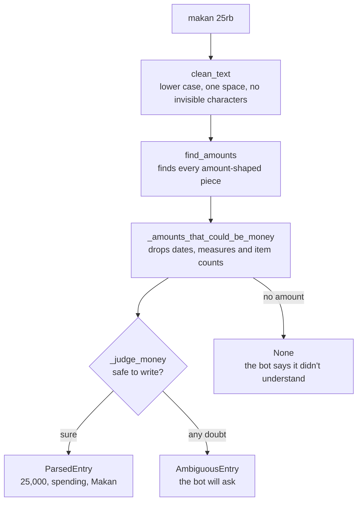

# Guide

This guide explains the repo in plain English. It covers slice 1, which is only
the parser. Later slices will add to it.

## The flow: one message, start to finish

Take the message `makan 25rb`. Nothing calls the parser yet except the tests;
from slice 3, the WhatsApp handler will.

1. **Clean the text.** `tracker/parsing/message.py: parse_message` calls
   `tracker/parsing/amount.py: clean_text`. It lower-cases the text, removes
   invisible characters and turns any run of whitespace into one space. The
   rest of the code can then assume a tidy string.
2. **Stop early.** Empty text, text longer than WhatsApp allows, and commands
   such as `rekap` return `None`.
3. **Find the numbers.** `amount.py: find_amounts` runs `_AMOUNT_PATTERN` over
   the text. For each piece that looks like an amount, `_read_match` works out
   its value. `25rb` becomes the number `25` and the unit `rb`.
4. **Read the number exactly.** `amount.py: _number_readings` decides what the
   dots and commas mean, and returns a `Decimal`, never a `float`. If a number
   has two honest readings it returns both; if it fits no form, none.
5. **Check the result.** `amount.py: _checked_rupiah` refuses anything that
   isn't whole, is zero, is over the limit, or is a bare number under 1,000.
   `25,000` passes, and comes back as the `int` 25000.
6. **Decide which number is the money.** `message.py:
   _amounts_that_could_be_money` drops numbers that aren't money: `tgl 25`,
   `5 kg`, and the `2` in `beli 2 kopi 50rb`.
7. **Judge the message.** `message.py: _judge_money` looks for reasons not to
   write: a foreign currency, a price per item, two amounts, part of a spelled
   number, or money that may not have moved (`mau beli`, `saldo`, a question).
   Each one gives an `Ambiguous` with a reason.
8. **Fill in the rest.** `_read_direction` and `_read_category` use the word
   lists in `tracker/parsing/keywords.py`, and `_describe` keeps the message
   without its amount: `makan`.
9. **Return.** `ParsedEntry(25000, spending, "Makan", "makan")`. Nothing is
   stored: this slice has no database.

## Two results, one rule

`parse_amount` and `parse_message` both have three possible answers:

| Answer | `parse_amount` | `parse_message` | What the bot will do |
|---|---|---|---|
| Sure | `int` | `ParsedEntry` | Write it, with an undo button |
| A person must decide | `Ambiguous` | `AmbiguousEntry` | Ask, or refuse if `candidates` is empty |
| Nothing to read | `None` | `None` | Say it didn't understand |

The rule behind all of it: **a wrong number is worse than a question.** Asking
costs one tap. A wrong amount costs trust in every total after it.

## How the tests are organised

- `tests/test_amount.py` and `tests/test_message.py` are the specification.
  Read a test's name to learn a rule.
- `tests/corpus/dev.jsonl` has labelled messages. `tests/test_corpus.py` checks
  each one.
- `tests/corpus/holdout.jsonl` is scored only as a whole, and the code is never
  tuned on it. [parser-accuracy.md](parser-accuracy.md) explains why.

## Glossary

| Word | Meaning | Where |
|---|---|---|
| **Amount** | Money as whole rupiah in an `int`. There are no fractions of a rupiah here | `amount.py` |
| **Bare number** | Digits alone, with no unit or `Rp`. Under 1,000 it needs a question | `FoundAmount.is_bare` |
| **Unit** | `rb`, `ribu`, `k`, `jt`, `juta`, `miliar`: they multiply the number | `UNIT_MULTIPLIERS` |
| **Remainder** | The `500` in `2jt500`. Only three digits are sure | `_read_remainder` |
| **Slang amount** | A word that means a sum: `goceng` is Rp5,000 | `SPELLED_AMOUNTS` |
| **Ambiguous** | Not safe to write. It holds a reason and the readings on offer | `amount.py` |
| **Candidates** | The readings a person could confirm. Empty means a refusal | `Ambiguous.candidates` |
| **Item count** | The `2` in `beli 2 kopi 50rb`: it counts things, it isn't money | `_is_item_count` |
| **Corpus** | Messages with the right answer written beside them | `tests/corpus/` |
| **Dev set** | The corpus the rules are written against | `dev.jsonl` |
| **Held-out set** | The corpus the rules never see while being written, so its score is honest | `holdout.jsonl` |
| **Coverage** | Of the messages about money, the share the rules handle with no model | `CorpusScore.coverage` |
| **Wrong amount** | The rules wrote a different number from the label. The target is 0 | `CorpusScore.wrong_amounts` |
| **False write** | The rules wrote something that should have been a question | `CorpusScore.false_writes` |
| **Mutation check** | Break the code on purpose and confirm a test fails | `[tool.mutmut]` in `pyproject.toml` |

## Where to change things

| To do this | Change this |
|---|---|
| Add a category keyword | `SPENDING_KEYWORDS` in `keywords.py` |
| Add an income word | `SALARY_WORDS` or `OTHER_INCOME_WORDS` in `keywords.py` |
| Add a command the parser must leave alone | `COMMAND_WORDS` in `keywords.py` |
| Add a slang amount | `SPELLED_AMOUNTS` in `amount.py`, or `AMBIGUOUS_SPELLED_AMOUNTS` if speakers disagree |
| Add a unit | `UNIT_MULTIPLIERS` in `amount.py` |
| Change a limit | `MIN_UNITLESS_RUPIAH` or `MAX_ENTRY_RUPIAH` in `amount.py` |
| Add a reason not to write | `NOT_A_TRANSACTION_PATTERN` in `keywords.py` |
| Add a corpus case | A line in `dev.jsonl`, following `tests/corpus/README.md`. Never edit `holdout.jsonl` to make a score better |

## Known limits

- **Several lines (P5) and dates (P6) aren't built.** Those are Should items.
  Two lines with amounts ask, and "kemarin makan 25rb" is read without its date.
- **Spelled-out numbers aren't read.** "lima ribu" gets `None`, not a wrong
  number. Only `seribu`, `sejuta` and the slang words are.
- **`seribu rasa` alone writes Rp1,000.** A spelled amount can also be part of a
  name. With a real amount beside it, the message asks.
- **Moving your own money counts as spending.** `nabung`, `tarik tunai` and
  `top up` have no type of their own, so P4's default applies. The reply shows
  it, and undo is one tap.
- **`cepek` always asks.** Some speakers mean Rp100, others Rp100,000, so the
  bot offers both. It's one line in `AMBIGUOUS_SPELLED_AMOUNTS`.
- **L6 isn't here.** Asking before entries above Rp10,000,000 belongs to the
  write path, in a later slice.
