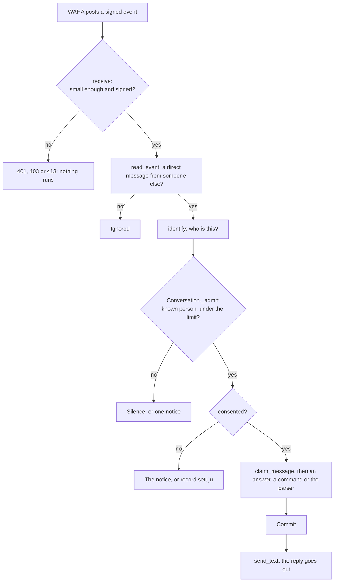
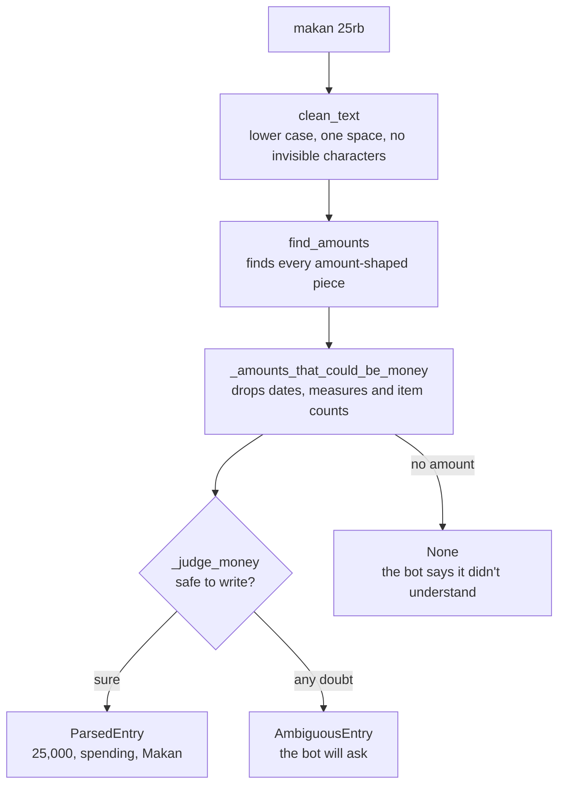
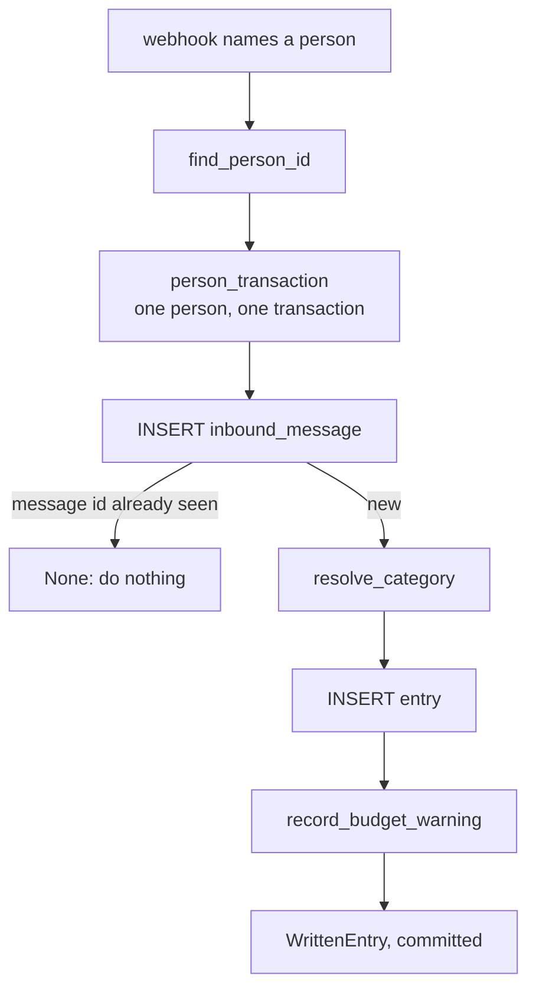

# Guide

This guide explains the repo in plain English. It covers the WhatsApp channel
(slice 3), the parser (slice 1) and the ledger (slice 2). Later slices will add to it.

## The flow: a webhook arrives

Someone sends `makan 25rb`. WAHA, a WhatsApp client running beside the app, posts it to
`/webhook`. This is the whole journey, up to the parser and the ledger, which have their
own sections below.

1. **Check before reading.** `tracker/channel/webhook.py: receive` caps the body at
   256 KB, then `check_signature` compares an HMAC-SHA-512 of the raw body. Nothing is
   parsed before that, so a forged request reaches no code.
2. **Read the event.** `tracker/channel/waha.py: read_event` turns it into an
   `IncomingMessage`, or nothing. It drops the bot's own messages, groups, broadcasts and
   channels, so the bot can't loop or reply where others can read.
3. **Work out who it is.** `identify` asks WAHA for the sender's LID and phone number.
   The LID is the stable id. `@c.us` is the phone number itself.
4. **Find the person.** `tracker/channel/conversation.py: _admit` asks the database
   who this is (`resolve_sender`). A stranger leaves a count and gets silence. Someone
   linked as `<number>@c.us` before WAHA knew their LID is moved onto the LID the first
   time it arrives with the same number (migration `0005`). Then
   `MessageLimiter.admit` checks the rate limits.
5. **Check consent.** Without it, the person gets the notice and nothing is stored about
   the message. `setuju` only counts for a notice they were sent.
6. **Claim the message.** `claim_message` records the message id. A repeat stops here.
7. **Answer.** `_answer` looks for a typed answer to an open question, then `batal`, then
   a command. Anything else goes to `parse_message`, and is written, asked about, or
   explained (`_log_message`).
8. **Commit, then reply.** The transaction ends, then `send_text` calls WAHA. If sending
   fails, the entry is safe and the failure is logged.

If anything fails before the commit, the transaction rolls back and the webhook
answers 500, so WAHA sends it again.

**Reply buttons don't work on WAHA,** so choices are typed. A question (`kopi 25`, or
anything above Rp10,000,000) becomes a row in `pending_entry`, and the person replies
`1`, `2`, `ya` or `batal`. Those words carry no id, so they can only reach the person's
newest question, and a new entry closes any open one. `batal` with no question open undoes
only the newest entry, so repeating it can't reach an older one.

**Text longer than WhatsApp allows** (4,096 characters) is answered as not understood by
`conversation.py: answer_without_the_ledger` before anything scans or cleans it, so a
huge body costs nothing. **A message that looks like a card, account or ID number** stops at
`tracker/parsing/sensitive.py: looks_sensitive`, before anything can store it. It doesn't
list separators: any short run of characters that aren't letters or digits (`.`, ` - `,
`:`, `|`...) joins two groups of digits, and digits from any script count. Amounts like
`1.500.000`, which never start with a zero, are taken out first. A number of three or more
digits after `pin`, `mpin`, `cvv`, `otp`, `sandi` or `password`, even with three words
between, counts too, and so does a grouped number right after `rek` or `rekening`. As a second
line, `hide_long_numbers` turns any number of 8 or more digits in a description into `#`,
and if 8 or more digits are left however they're split, every number goes.

**Leaving** is in `tracker/channel/leaving.py`. `ekspor` sends a CSV of the person's own
records. `hapus data saya` asks first, and `hapus semua` within ten minutes marks the
person's deletion as confirmed (`people.py: confirm_deletion`), which makes them a stranger
at once. The app login can't delete: every 15 minutes, `export_deletions.sh` runs
`tracker deletions-run` under the owner login, which calls `tracker_delete_person_in_scope`
for each confirmed person (`deletions.py: run_confirmed_deletions`). More than two
deletions in 24 hours looks like a taken-over app confirming for others, so it deletes
none, fails, and the heartbeat alerts Arthur. A trigger stops the app undoing a
confirmation. Only their id stays, in `deleted_person`, so a deletion can be
re-applied after a restore.

**Everything WhatsApp-specific is behind `tracker/channel/gateway.py`.** To replace WAHA,
write one more class with those four methods. Nothing else changes.

## The flow: one message, start to finish

Take the message `makan 25rb`, which `tracker/channel/conversation.py` hands to the parser.

1. **Clean the text.** `tracker/parsing/message.py: parse_message` calls
   `tracker/parsing/amount.py: clean_text`. It lower-cases the text, removes
   invisible characters and turns any run of whitespace into one space. The
   rest of the code can then assume a tidy string.
2. **Stop early.** Empty text, text longer than WhatsApp allows, and commands
   such as `rekap` return `None`.
3. **Find the numbers.** `amount.py: find_amounts` runs `_AMOUNT_PATTERN` over
   the text. For each piece that looks like an amount, `_read_match` works out
   its value. `25rb` becomes the number `25` and the unit `rb`. A run of number
   words such as `lima puluh ribu` goes to `tracker/parsing/spelled.py:
   spelled_number_readings` instead, which reads it word by word.
4. **Read the number exactly.** `amount.py: _number_readings` decides what the
   dots and commas mean, and returns a `Decimal`, never a `float`. If a number
   has two honest readings it returns both; if it fits no form, none.
5. **Check the result.** `amount.py: _checked_rupiah` refuses anything that
   isn't whole, is zero, is over the limit, or is a bare number under 1,000.
   `25,000` passes, and comes back as the `int` 25000.
6. **Decide which number is the money.** `message.py:
   _amounts_that_could_be_money` drops numbers that aren't money: `tgl 25`,
   `5 kg`, and the `2` in `beli 2 kopi 50rb`.
7. **Judge the message.** `message.py: _judge_money` looks for reasons not to
   write: a foreign currency, a price per item, two amounts, part of a spelled
   number, or money that may not have moved (`mau beli`, `saldo`, a question).
   Each one gives an `Ambiguous` with a reason.
8. **Fill in the rest.** `_read_direction` and `_read_category` use the word
   lists in `tracker/parsing/keywords.py`, and `_describe` keeps the message
   without its amount: `makan`.
9. **Return.** `ParsedEntry(25000, spending, "Makan", "makan")`. The parser
   stores nothing. The next section picks up from here.

## The flow: from a parsed entry to the database

`tracker/channel/conversation.py` calls this for each message.

1. **Find the person.** `tracker/ledger/people.py: resolve_sender` turns the
   webhook's id into a `person.id`. It calls a small database function, because
   the app can't read the person table until a person is in scope.
2. **Open a scope.** `tracker/ledger/scope.py: person_transaction` starts a
   transaction and sets `tracker.person_id` for that transaction only. Every
   ledger function takes the resulting `PersonScope`, so none can run without a
   person.
3. **Claim the message.** `tracker/ledger/entries.py: claim_message` inserts the
   message id. If it's already there, this is a repeat delivery, and the function
   returns `None`.
4. **Choose the category.** `tracker/ledger/categories.py: resolve_category`
   checks the words this person taught it first, then uses the parser's category.
5. **Write the entry.** Amount, direction, category and description, in the same
   transaction as the message id. If anything fails, both roll back, so a retry
   isn't mistaken for a repeat.
6. **Check the budget.** `tracker/ledger/budgets.py: record_budget_warning` works
   out what's used this month, in SQL. Inserting into `budget_warning` is what
   makes each warning arrive once.
7. **Commit, then reply.** The entry is safe before any message goes out.

Undo is `entries.py: void_entry`. It sets `voided_at` and changes nothing else,
and every total ignores voided entries.

## How it runs on the server

Two containers, in `ops/compose.yaml`: the app and WAHA. Nothing is published to the
internet. WAHA connects out to WhatsApp, and calls the app over a private network. The
monitoring stack reaches the app over its own network, and reads its log from a file. Both
run as user 10001 with a read-only root. The app's environment never holds the owner's
login: migrations and Arthur's CLI run in separate, one-off containers.

A nightly `ops/backup/backup_tracker.sh` streams the database into `age` and up to S3; it
then runs the purge of expired records, under the same heartbeat. It never deletes from the
bucket, and the server's key can't: the bucket's lifecycle rule (`ops/backup/s3-lifecycle.json`)
expires old dumps within 13 days instead, so a taken-over server can't destroy the backups. Versioning keeps
an overwritten copy for 4 days. `ops/backup/check_bucket.sh`, run with Arthur's own login,
names any dump that was overwritten, and merges every copy of the deletion list for a restore. Compose
reads its own settings from `ops/.env` (see `ops/.env.example`), so cron sees them too.
Every 15 minutes, `ops/backup/export_deletions.sh` runs
`tracker deletions-export`, which copies the ids of people who left to `ops/deletions/`, a
folder no backup touches, and then merges it into the bucket's `tracker-deletions/` copy,
which the lifecycle rule never reaches and which only ever grows. After a restore, `tracker deletions-reapply` deletes them
again, records them as deleted, and moves the id counter past them so nobody new gets a
deleted person's id. A missing or empty list is an error, never "nobody to delete". Both
scripts share `ops/backup/settings.sh`. `docs/runbook-deploy.md` has every step, and
`docs/go-live.md` puts them in order, from a local pairing test to the gate and back out.

## Security comes first

This holds people's financial records, so when security conflicts with speed,
features or cost, security wins. That's Arthur's decision, recorded in ADR-020.

- [threat-model.md](planning/threat-model.md) lists every threat, its control,
  its proof, and the slice that owns it.
- [The real-data gate](planning/slice-plan.md#the-real-data-gate) must pass before
  any real person's data, Arthur's included, enters the system.
- CI scans all history for secrets (gitleaks) and checks every locked dependency
  for known holes (`uv audit`).

To add something that touches people's data, find its threat first. If the threat
isn't there, add it. If a control has no named threat, it doesn't belong.

## How one person is kept from another's data

There are two layers, so one forgotten filter doesn't expose anyone:

1. **The code.** Every query has `person_id = :person_id`, from the scope.
2. **The database.** Row-level security limits the `tracker_app` login to the
   person set for the transaction. With no person set, every table looks empty.

Two traps are handled in `migrations/versions/0001_ledger.py`:

- **Foreign keys ignore row-level security.** So each link between people's
  tables includes `person_id`: an entry can't point at someone else's category.
- **A setting from a past transaction reads as `''`, not `NULL`.** So the
  function reading it uses `NULLIF`, and a reused connection sees no rows
  instead of an error.

Row-level security catches a forgotten `WHERE`. It doesn't stop SQL injection,
because the app may set the person itself. Bound parameters do that job.

`tests/test_ledger_isolation.py` tests each layer without the other.

## Two results, one rule

`parse_amount` and `parse_message` both have three possible answers:

| Answer | `parse_amount` | `parse_message` | What the bot will do |
|---|---|---|---|
| Sure | `int` | `ParsedEntry` | Write it, and say `batal` undoes it |
| A person must decide | `Ambiguous` | `AmbiguousEntry` | Ask, or refuse if `candidates` is empty |
| Nothing to read | `None` | `None` | Say it didn't understand |

The rule behind all of it: **a wrong number is worse than a question.** Asking
costs one reply. A wrong amount costs trust in every total after it.

## How the tests are organised

- `tests/test_amount.py` and `tests/test_message.py` are the specification.
  Read a test's name to learn a rule.
- `tracker/corpus/dev.jsonl` has labelled messages. `tests/test_corpus.py` checks
  each one.
- `tracker/corpus/holdout.jsonl` is scored only as a whole, and the code is never
  tuned on it. [parser-accuracy.md](parser-accuracy.md) explains why. Nine
  labelling examples from the corpus README are in both sets.

## How the ledger's checks were tested

- **mutmut:** 910 mutants of `tracker/`; 902 caught. All 8 survivors are
  equivalent: 6 only lower-case the SQL, `datetime.now(None)` still gives the
  same instant, and `len(remainder) >= 3` can't differ, because 3 has returned.
- **By hand:** mutmut can't touch the migration, so 49 protections were broken
  one at a time: policies, grants, foreign keys, checks and each code filter.
  Tests caught 48. The other, `e.person_id = b.person_id` in the budget query, is
  equivalent, because a category has one owner. It stays so the index is used.

## Glossary

| Word | Meaning | Where |
|---|---|---|
| **Amount** | Money as whole rupiah in an `int`. There are no fractions of a rupiah here | `amount.py` |
| **Bare number** | Digits alone, with no unit or `Rp`. Under 1,000 it needs a question | `FoundAmount.is_bare` |
| **Unit** | `rb`, `ribu`, `k`, `jt`, `juta`, `miliar`: they multiply the number | `UNIT_MULTIPLIERS` |
| **Remainder** | The `500` in `2jt500`. Only three digits are sure | `_read_remainder` |
| **Slang amount** | A word that means a sum: `goceng` is Rp5,000 | `SPELLED_AMOUNTS` |
| **Spelled amount** | Number words with a scale word: `lima puluh ribu` is Rp50,000 | `spelled.py` |
| **Scale word** | `ribu`, `juta` or `miliar` (or `rb`, `jt`). Without one, number words aren't read as money | `SCALE_WORDS` |
| **Ambiguous** | Not safe to write. It holds a reason and the readings on offer | `amount.py` |
| **Candidates** | The readings a person could confirm. Empty means a refusal | `Ambiguous.candidates` |
| **Item count** | The `2` in `beli 2 kopi 50rb`: it counts things, it isn't money | `_is_item_count` |
| **Corpus** | Messages with the right answer written beside them | `tracker/corpus/` |
| **Dev set** | The corpus the rules are written against | `dev.jsonl` |
| **Held-out set** | The corpus the rules never see while being written, so its score is honest | `holdout.jsonl` |
| **Coverage** | Of the messages about money, the share the rules handle with no model | `CorpusScore.coverage` |
| **Wrong amount** | The rules wrote a different number from the label. The target is 0 | `CorpusScore.wrong_amounts` |
| **False write** | The rules wrote something that should have been a question | `CorpusScore.false_writes` |
| **Scope** | One transaction limited to one person | `PersonScope` |
| **Row-level security (RLS)** | Postgres hides rows by a rule on the table, whatever the query says | `0001_ledger.py` |
| **Void** | Undo: mark the entry, keep the row | `entries.py: void_entry` |
| **Repeat delivery** | The same message arrives twice. The unique message id makes the second do nothing | `inbound_message` |
| **Taught word** | A word a person linked to a category with `kategori transport` | `category_keyword` |
| **Period** | A date range, from a start up to but not including an end | `summaries.py: Period` |
| **WAHA** | A self-hosted, unofficial WhatsApp client with an HTTP API. It runs beside the app and acts as a linked device | `ops/waha/`, `channel/waha.py` |
| **Gateway** | The one small interface that hides WAHA from the rest of the code | `channel/gateway.py` |
| **Session files** | What keeps WAHA logged in. Whoever holds them is the bot's WhatsApp account | `ops/waha/sessions/`, never committed |
| **Webhook** | WAHA's HTTP call to us when a message arrives | `channel/webhook.py` |
| **Signature** | A hash of the body made with a secret only WAHA and we hold, proving WAHA sent it | `check_signature` |
| **LID** | WhatsApp's id for a person, ending `@lid`, which isn't their phone number | `Sender.whatsapp_id` |
| **Allow-list** | Only people Arthur added can use the bot | `person`, `tracker/cli.py` |
| **Pending entry** | An entry waiting for a person's typed answer, for up to 24 hours | `ledger/pending.py` |
| **Consent notice** | What a person reads and agrees to before anything is stored. Its text is pinned to a version | `replies.py` |
| **Suspension** | Arthur stops every read and write for a person | `tracker suspend` |
| **Restore drill** | Restoring a backup into an empty database, timed, to prove backups work | `docs/runbook-deploy.md` |
| **Span** | One timed step in a trace. Ours hold names and outcomes, never content | `channel/tracing.py` |
| **Outcome** | What became of a message, with no text, so misses can be counted | `inbound_message.outcome` |
| **Reply limit** | A cap on sends across everyone. It replaced Meta's cap: a burst risks a ban | `channel/ratelimit.py` |
| **Purge** | The job that deletes what's past keeping | `ledger/retention.py` |
| **Threat model** | The list of what could go wrong, and what stops each thing | `docs/planning/threat-model.md` |
| **Real-data gate** | The checklist that must pass before any real person's data enters the system | `docs/planning/slice-plan.md` |
| **Fail closed** | When a check can't run, refuse rather than let the request through | Slice 3's webhook |
| **Secret scan** | A search of every commit for keys and tokens | gitleaks in `ci.yml` |
| **Dependency audit** | A check of every locked package against known vulnerabilities | `uv audit` in `ci.yml` |
| **Mutation check** | Break the code on purpose and confirm a test fails | `[tool.mutmut]` in `pyproject.toml` |

## Where to change things

| To do this | Change this |
|---|---|
| Add a category keyword | `SPENDING_KEYWORDS` in `keywords.py` |
| Add an income word | `SALARY_WORDS` or `OTHER_INCOME_WORDS` in `keywords.py` |
| Add a command the parser must leave alone | `COMMAND_WORDS` in `keywords.py` |
| Add a slang amount | `SPELLED_AMOUNTS` in `amount.py`, or `AMBIGUOUS_SPELLED_AMOUNTS` if speakers disagree |
| Add a unit | `UNIT_MULTIPLIERS` in `amount.py` |
| Add a number word | `DIGIT_WORDS`, `SCALE_WORDS` or `SE_SCALE_WORDS` in `spelled.py` |
| Change a limit | `MIN_UNITLESS_RUPIAH` or `MAX_ENTRY_RUPIAH` in `amount.py` |
| Add a reason not to write | `NOT_A_TRANSACTION_PATTERN` in `keywords.py` |
| Change the schema | A new file in `migrations/versions/`. Never edit a migration that has run |
| Add a table | A migration, with `person_id`, row-level security and the least grants; add it to `PERSON_TABLES` in `tests/test_ledger_isolation.py` |
| Change the starter categories | `SPENDING_KEYWORDS` in `keywords.py`; a new person picks them up from `people.py: STARTER_CATEGORIES` |
| Change the warning levels | `WARNING_PERCENTS` in `budgets.py`, and the check on `budget_warning` |
| Change what the bot says | `tracker/channel/replies.py` |
| Change the consent notice | Its text and `CONSENT_NOTICE_VERSION` together, then the pinned hash in `tests/test_channel_security.py`. People agreed to the old text |
| Add a command | `run_command` in `channel/commands.py`, and `COMMAND_WORDS` in `keywords.py` so the parser leaves it alone |
| Replace WAHA | A new class implementing `Gateway`, then `create_app`. Nothing else knows |
| Upgrade WAHA | The digest in `ops/waha/compose.yaml`, tested on the spare number first |
| Deploy, or check a gate line on the server | `docs/runbook-deploy.md` |
| Change how long backups are kept | `KEEP` in `ops/backup/backup_tracker.sh`, and the notice's "14 hari" with it |
| Get someone's records without WhatsApp | `tracker export <id> <file>`, with the owner's login |
| Change a rate limit or the reply limit | `channel/ratelimit.py` |
| Change what's kept, and for how long | `ledger/retention.py`, and PR6 in Phase 2 |
| Delete someone without WhatsApp | `tracker delete <id> --yes`, with the owner's login |
| Clear a deletion hold | Check each id `deletions-run` printed, then `tracker delete <id> --yes` or `tracker deletion-cancel <id>` |
| Change how many deletions a day may bring | `MAX_DELETIONS_PER_DAY` in `ledger/deletions.py`, and ADR-023 |
| Check the deployed version | `GET /healthz` gives `status` and `version` |
| Add a person | `tracker add 628...`, with the owner's login |
| Stop a person | `tracker suspend <id>`, then `tracker resume <id>` |
| Add a threat or a control | A row in `docs/planning/threat-model.md`, with its proof and owning slice |
| Add a corpus case | A line in `dev.jsonl`, following `tracker/corpus/README.md`. Never edit `holdout.jsonl` to make a score better |

## Known limits

- **Several lines (P5) and dates (P6) aren't built.** Those are Should items.
  Two lines with amounts ask, and "kemarin makan 25rb" is read without its date.
- **Spelled-out numbers need a scale word.** `lima puluh ribu` is read, but
  `kopi dua puluh lima` gets `None`, like a bare number it could be Rp25 or
  Rp25,000. `seperempat juta` isn't read either.
- **Some spelled amounts ask.** `dua juta lima ratus` may drop a `ribu`, and the
  `dua` in `lima puluh ribu dua` may count plates, so both offer two readings.
  Hundreds after `ribu` are sure: `seribu lima ratus` is Rp1,500.
- **`seribu rasa` alone writes Rp1,000.** A spelled amount can also be part of a
  name. With a real amount beside it, the message asks.
- **Moving your own money counts as spending.** `nabung`, `tarik tunai` and
  `top up` have no type of their own, so P4's default applies. The reply shows
  it, and `batal` undoes it.
- **`cepek` always asks.** Some speakers mean Rp100, others Rp100,000, so the
  bot offers both. It's one line in `AMBIGUOUS_SPELLED_AMOUNTS`.
- **A reply that still fails after retries is dropped.** The entry is safe, but the
  person isn't told. A send is only retried if it can't have arrived.
- **Past the reply limit, a question goes unasked.** Entries still log, and the open
  question simply expires.
- **Unparsed text isn't kept at all.** PR5 allows 30 days for Arthur's own, but nothing
  needs it yet, so nothing stores it.
- **An edited message changes nothing.** WhatsApp lets people edit a message, and
  the bot keeps the first version.
- **A repeat of a message before consent sends the notice again.** Nothing may be
  stored before **setuju**, and that includes the message id.
- **The channel hasn't met WhatsApp.** WAHA's event shapes come from its docs, and no
  number has been linked. See "The live check" in the slice plan.
- **The number can be banned without warning.** Records are safe, but replies stop until
  a new number is linked. See ADR-022.
- **A person known only by `@c.us` keeps the recycled-number risk,** because that id is
  the number, and moving them onto a LID trusts whoever holds the number then. Arthur
  accepted this on 2026-11-04 (threat model, T12). A person with a LID doesn't carry it.
- **`batal` undoes the newest entry at any age.** The reply names what was undone.
- **Two entries at the same moment can miss a warning.** Neither sees the other
  before it commits. The next entry in that category gives the warning.
