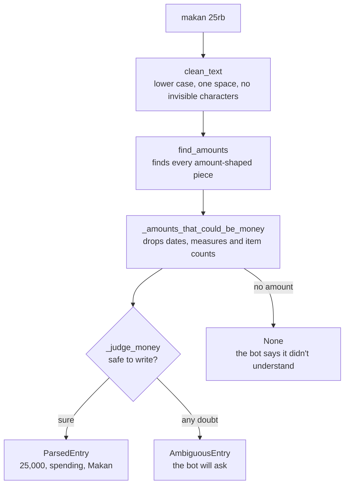
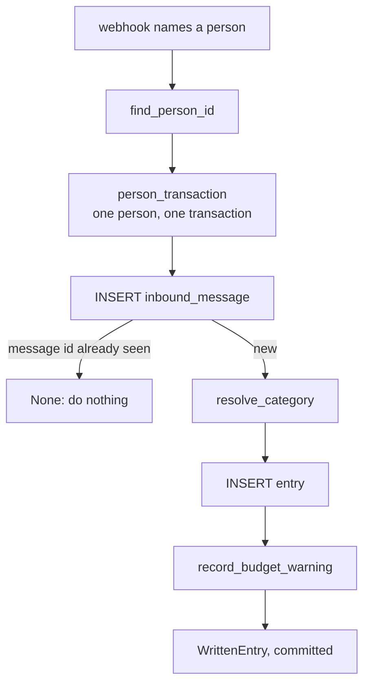

# Guide

This guide explains the repo in plain English. It covers the parser (slice 1)
and the ledger (slice 2). Later slices will add to it.

## The flow: one message, start to finish

Take the message `makan 25rb`. Nothing calls the parser yet except the tests;
from slice 3, the WhatsApp handler will.

1. **Clean the text.** `tracker/parsing/message.py: parse_message` calls
   `tracker/parsing/amount.py: clean_text`. It lower-cases the text, removes
   invisible characters and turns any run of whitespace into one space. The
   rest of the code can then assume a tidy string.
2. **Stop early.** Empty text, text longer than WhatsApp allows, and commands
   such as `rekap` return `None`.
3. **Find the numbers.** `amount.py: find_amounts` runs `_AMOUNT_PATTERN` over
   the text. For each piece that looks like an amount, `_read_match` works out
   its value. `25rb` becomes the number `25` and the unit `rb`.
4. **Read the number exactly.** `amount.py: _number_readings` decides what the
   dots and commas mean, and returns a `Decimal`, never a `float`. If a number
   has two honest readings it returns both; if it fits no form, none.
5. **Check the result.** `amount.py: _checked_rupiah` refuses anything that
   isn't whole, is zero, is over the limit, or is a bare number under 1,000.
   `25,000` passes, and comes back as the `int` 25000.
6. **Decide which number is the money.** `message.py:
   _amounts_that_could_be_money` drops numbers that aren't money: `tgl 25`,
   `5 kg`, and the `2` in `beli 2 kopi 50rb`.
7. **Judge the message.** `message.py: _judge_money` looks for reasons not to
   write: a foreign currency, a price per item, two amounts, part of a spelled
   number, or money that may not have moved (`mau beli`, `saldo`, a question).
   Each one gives an `Ambiguous` with a reason.
8. **Fill in the rest.** `_read_direction` and `_read_category` use the word
   lists in `tracker/parsing/keywords.py`, and `_describe` keeps the message
   without its amount: `makan`.
9. **Return.** `ParsedEntry(25000, spending, "Makan", "makan")`. The parser
   stores nothing. The next section picks up from here.

## The flow: from a parsed entry to the database

Nothing calls this yet except the tests; from slice 3, the WhatsApp handler will.

1. **Find the person.** `tracker/ledger/people.py: find_person_id` turns the
   webhook's id into a `person.id`. It calls a small database function, because
   the app can't read the person table until a person is in scope.
2. **Open a scope.** `tracker/ledger/scope.py: person_transaction` starts a
   transaction and sets `tracker.person_id` for that transaction only. Every
   ledger function takes the resulting `PersonScope`, so none can run without a
   person.
3. **Claim the message.** `tracker/ledger/entries.py: write_entry` inserts Meta's
   message id. If it's already there, this is a repeat delivery, and the function
   returns `None`.
4. **Choose the category.** `tracker/ledger/categories.py: resolve_category`
   checks the words this person taught it first, then uses the parser's category.
5. **Write the entry.** Amount, direction, category and description, in the same
   transaction as the message id. If anything fails, both roll back, so a retry
   isn't mistaken for a repeat.
6. **Check the budget.** `tracker/ledger/budgets.py: record_budget_warning` works
   out what's used this month, in SQL. Inserting into `budget_warning` is what
   makes each warning arrive once.
7. **Commit, then reply.** The entry is safe before any message goes out.

Undo is `entries.py: void_entry`. It sets `voided_at` and changes nothing else,
and every total ignores voided entries.

## How one person is kept from another's data

There are two layers, so one forgotten filter doesn't expose anyone:

1. **The code.** Every query has `person_id = :person_id`, from the scope.
2. **The database.** Row-level security limits the `tracker_app` login to the
   person set for the transaction. With no person set, every table looks empty.

Two traps are handled in `migrations/versions/0001_ledger.py`:

- **Foreign keys ignore row-level security.** So each link between people's
  tables includes `person_id`: an entry can't point at someone else's category.
- **A setting from a past transaction reads as `''`, not `NULL`.** So the
  function reading it uses `NULLIF`, and a reused connection sees no rows
  instead of an error.

Row-level security catches a forgotten `WHERE`. It doesn't stop SQL injection,
because the app may set the person itself. Bound parameters do that job.

`tests/test_ledger_isolation.py` tests each layer without the other.

## Two results, one rule

`parse_amount` and `parse_message` both have three possible answers:

| Answer | `parse_amount` | `parse_message` | What the bot will do |
|---|---|---|---|
| Sure | `int` | `ParsedEntry` | Write it, with an undo button |
| A person must decide | `Ambiguous` | `AmbiguousEntry` | Ask, or refuse if `candidates` is empty |
| Nothing to read | `None` | `None` | Say it didn't understand |

The rule behind all of it: **a wrong number is worse than a question.** Asking
costs one tap. A wrong amount costs trust in every total after it.

## How the tests are organised

- `tests/test_amount.py` and `tests/test_message.py` are the specification.
  Read a test's name to learn a rule.
- `tests/corpus/dev.jsonl` has labelled messages. `tests/test_corpus.py` checks
  each one.
- `tests/corpus/holdout.jsonl` is scored only as a whole, and the code is never
  tuned on it. [parser-accuracy.md](parser-accuracy.md) explains why.

## Glossary

| Word | Meaning | Where |
|---|---|---|
| **Amount** | Money as whole rupiah in an `int`. There are no fractions of a rupiah here | `amount.py` |
| **Bare number** | Digits alone, with no unit or `Rp`. Under 1,000 it needs a question | `FoundAmount.is_bare` |
| **Unit** | `rb`, `ribu`, `k`, `jt`, `juta`, `miliar`: they multiply the number | `UNIT_MULTIPLIERS` |
| **Remainder** | The `500` in `2jt500`. Only three digits are sure | `_read_remainder` |
| **Slang amount** | A word that means a sum: `goceng` is Rp5,000 | `SPELLED_AMOUNTS` |
| **Ambiguous** | Not safe to write. It holds a reason and the readings on offer | `amount.py` |
| **Candidates** | The readings a person could confirm. Empty means a refusal | `Ambiguous.candidates` |
| **Item count** | The `2` in `beli 2 kopi 50rb`: it counts things, it isn't money | `_is_item_count` |
| **Corpus** | Messages with the right answer written beside them | `tests/corpus/` |
| **Dev set** | The corpus the rules are written against | `dev.jsonl` |
| **Held-out set** | The corpus the rules never see while being written, so its score is honest | `holdout.jsonl` |
| **Coverage** | Of the messages about money, the share the rules handle with no model | `CorpusScore.coverage` |
| **Wrong amount** | The rules wrote a different number from the label. The target is 0 | `CorpusScore.wrong_amounts` |
| **False write** | The rules wrote something that should have been a question | `CorpusScore.false_writes` |
| **Scope** | One transaction limited to one person | `PersonScope` |
| **Row-level security (RLS)** | Postgres hides rows by a rule on the table, whatever the query says | `0001_ledger.py` |
| **BSUID** | Meta's id for a person, which stays put when the phone number changes | `person.bsuid` |
| **Void** | Undo: mark the entry, keep the row | `entries.py: void_entry` |
| **Repeat delivery** | Meta sends the same message twice. The unique message id makes the second do nothing | `inbound_message` |
| **Taught word** | A word a person linked to a category with `kategori transport` | `category_keyword` |
| **Period** | A date range, from a start up to but not including an end | `summaries.py: Period` |
| **Mutation check** | Break the code on purpose and confirm a test fails | `[tool.mutmut]` in `pyproject.toml` |

## Where to change things

| To do this | Change this |
|---|---|
| Add a category keyword | `SPENDING_KEYWORDS` in `keywords.py` |
| Add an income word | `SALARY_WORDS` or `OTHER_INCOME_WORDS` in `keywords.py` |
| Add a command the parser must leave alone | `COMMAND_WORDS` in `keywords.py` |
| Add a slang amount | `SPELLED_AMOUNTS` in `amount.py` |
| Add a unit | `UNIT_MULTIPLIERS` in `amount.py` |
| Change a limit | `MIN_UNITLESS_RUPIAH` or `MAX_ENTRY_RUPIAH` in `amount.py` |
| Add a reason not to write | `NOT_A_TRANSACTION_PATTERN` in `keywords.py` |
| Change the schema | A new file in `migrations/versions/`. Never edit a migration that has run |
| Add a table | A migration, with `person_id`, row-level security and the least grants; add it to `PERSON_TABLES` in `tests/test_ledger_isolation.py` |
| Change the starter categories | `SPENDING_KEYWORDS` in `keywords.py`; a new person picks them up from `people.py: STARTER_CATEGORIES` |
| Change the warning levels | `WARNING_PERCENTS` in `budgets.py`, and the check on `budget_warning` |
| Add a corpus case | A line in `dev.jsonl`, following `tests/corpus/README.md`. Never edit `holdout.jsonl` to make a score better |

## Known limits

- **Several lines (P5) and dates (P6) aren't built.** Those are Should items.
  Two lines with amounts ask, and "kemarin makan 25rb" is read without its date.
- **Spelled-out numbers aren't read.** "lima ribu" gets `None`, not a wrong
  number. Only `seribu`, `sejuta` and the slang words are.
- **`seribu rasa` alone writes Rp1,000.** A spelled amount can also be part of a
  name. With a real amount beside it, the message asks.
- **Moving your own money counts as spending.** `nabung`, `tarik tunai` and
  `top up` have no type of their own, so P4's default applies. The reply shows
  it, and undo is one tap.
- **`cepek` is Rp100,** as P1 lists it, though some speakers use it for
  Rp100,000 in context. It is one line in `SPELLED_AMOUNTS` to change.
- **L6 isn't here.** Asking before entries above Rp10,000,000 needs a pending
  entry, so it comes with buttons in slice 3.
- **Consent isn't checked yet.** I4 arrives with the consent flow in slice 3, so
  nothing may call `write_entry` before that.
- **Deleting a person isn't here.** `hapus data saya` is slice 4, which needs a
  way past "the app can delete nothing".
- **Two entries at the same moment can miss a warning.** Neither sees the other
  before it commits. The next entry in that category gives the warning.
