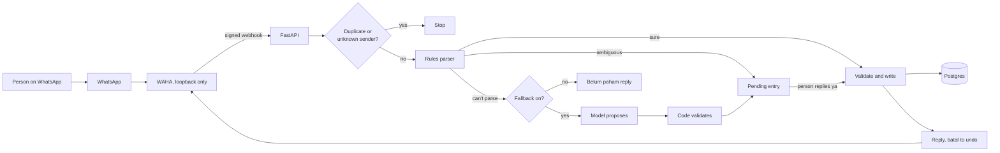

# Phase 2: Requirements & Constraints

Phases 3 (threats) and 4 (design) are folded into this doc and Phase 5, as
in Juku. The build goes in slices ([slice plan](slice-plan.md)).

## Core scenario

1. **Joining.** Arthur adds a person's number with a CLI command. They send
   the bot any message. The bot replies with a short notice in Indonesian:
   what is stored, that this is an unofficial channel, and who can see what. They
   reply **setuju**. Nothing is stored about their messages before that.
2. **Logging.** "makan 25rb".
   1. WAHA posts a signed webhook; the app checks the signature.
   2. It records the message id, so a repeat delivery does nothing.
   3. The rules parse the text.
   4. Code validates and writes the entry.
   5. The bot replies "Tercatat pengeluaran: Makan Rp25.000", and says **batal** undoes it.
3. **When it isn't sure.** "kopi 25" could be Rp25 or Rp25.000. The bot asks
   before writing anything, and the person replies **1**, **2** or **batal**.
4. **When rules can't parse it.** With the fallback off (the v1 default),
   the bot says what it understood and gives an example. With it on, the
   model proposes, code validates, and the person confirms.
5. **Budgets.** "budget makan 2jt" sets a monthly limit. When an entry
   crosses 80% or 100%, the warning is part of that entry's reply.
6. **Summaries.** "rekap" gives this month's totals per category, computed
   in SQL. Last month's summary goes with a person's first reply of the month.
7. **Leaving.** "hapus data saya", confirmed by a typed reply, deletes
   everything about that person.

## Requirements

**Parsing (rules, $0)**
- **P1. Amount forms:** `25rb`, `25 ribu`, `25k`, `25.000`, `25,000`,
  `Rp25.000`, `1,5jt`, `1.5jt`, `2jt500`, `sejuta`, and slang (`goceng`,
  `ceban`, `gopek`), each pinned in the corpus. `cepek` always asks: some
  speakers mean Rp100, others Rp100,000.
- **P2.** Amounts are parsed with `Decimal` from the text, never `float`.
  A result that isn't a whole number of rupiah is refused.
- **P3. Ambiguity is never guessed.** A bare number under
  `MIN_UNITLESS_RUPIAH` (1,000) asks first. So does a message with two
  possible amounts, such as "beli 2 kopi 50rb" if the rules can't tell.
- **P4.** Income and spending are told apart by keywords (`gaji`, `terima`,
  `dapat`), defaulting to spending. The reply always says which it was.
- **P5 (Should).** Several lines in one message are several entries.
- **P6 (Should).** Dates: `kemarin`, `2 hari lalu`, or a named date. The
  default is today, in Asia/Jakarta.

**The ledger (ADR-006)**
- **L1.** Amounts are `BIGINT` whole rupiah. No `float`, `numeric` with
  decimals, or `str` holds money anywhere, and a test scans for it.
- **L2.** Each amount is above 0 and at most `MAX_ENTRY_RUPIAH`
  (1,000,000,000). The direction is a separate column, never a sign.
- **L3.** Undo sets `voided_at`. It never deletes or edits. A correction is
  a void plus a new entry.
- **L4.** Undo is safe to repeat, and works only on the sender's own entry.
- **L5.** Writes are unique on the message id, so a repeat delivery
  can't add a second entry.
- **L6.** An entry above `MAX_UNCONFIRMED_RUPIAH` (10,000,000) always asks
  first, even when the rules are sure.

**The model fallback (ADR-007, off in v1)**
- **M1.** The model returns a typed proposal and has no tools. It sees one
  message, with no name, number or history.
- **M2.** The model never supplies the amount as a number. It returns
  `amount_text`, which must be an exact substring of the message and must
  pass the same amount parser as P1.
- **M3.** Every proposal needs a person's **ya**. Pending proposals expire
  after `PENDING_EXPIRY_HOURS` (24).
- **M4.** A failed, slow or refused model call falls back to the "belum
  paham" reply. It never blocks a message.
- **M5.** Calls are capped per person per day (`MAX_MODEL_CALLS_PER_DAY`).

**Categories**
- **C1.** A fixed starter list per person (Makan, Transport, Belanja,
  Tagihan, Hiburan, Kesehatan, Lainnya; Gaji and Pemasukan Lain for income).
- **C2.** Assigned by keyword in code. No match means Lainnya.
- **C3.** "kategori transport", right after an entry, changes it and
  remembers the word for that person.

**Summaries and budgets**
- **S1.** `rekap`, `rekap minggu ini` and `rekap <bulan>` are computed in
  SQL and exclude voided entries. Months are cut at midnight Asia/Jakarta.
- **S2.** Formatting uses Indonesian grouping (`Rp1.500.000`).
- **B1.** `budget <kategori> <jumlah>` sets a monthly limit; `budget` lists
  them with the amount used.
- **B2.** Warnings at 80% and 100% are sent **once** per category and month,
  inside the entry's reply (ADR-011).
- **B3.** Undoing an entry recalculates the budget.
- **B4.** Last month's total goes with a person's first reply of the month. It can't
  be sent twice for one month, and the bot never starts a conversation (ADR-022).

**Identity and consent (ADR-008, ADR-009)**
- **I1.** The sender's identity comes only from the signed webhook. No
  command takes a user id.
- **I2.** Users are keyed on their `@lid` when WAHA gives one, otherwise on `@c.us`.
  Arthur adds them by number, and the number is dropped once a LID is known. A sender
  that can't be resolved is a stranger.
- **I3.** Unknown senders get no reply, which also costs nothing. Only a
  count is kept, not their number.
- **I4.** No entry is stored before **setuju**, and the time is recorded.
- **I5.** Database-level isolation between people, tested (ADR-009).
- **I6.** `hapus data saya`, confirmed with `hapus semua` within ten minutes, deletes
  every row for that person. **`ekspor`** sends
  their data as a CSV. It's a Must now, as is **`tracker export`**, which works with
  WAHA stopped, because the channel can vanish (ADR-022).
- **I7.** The consent record holds the time and the version of the notice
  agreed to.
- **I8.** Arthur can suspend a person, which stops every read and write for
  them, if a phone is lost.

**Privacy (ADR-010)**
- **PR1.** Message text is stored only as far as needed: the entry's short
  description. Webhook payloads aren't stored.
- **PR2.** Logs, traces and metrics hold no message text, amounts, names or
  numbers.
- **PR3.** A message containing what looks like a card or account number
  (13 to 19 digits, or a Luhn match) isn't stored or sent to a model. The
  bot asks the person to delete it.
- **PR4.** Backups are encrypted and verified before any real data is
  stored.
- **PR5.** Unparsed text is kept 30 days for Arthur's account only, to
  improve the rules. Other people's failures are counted, never kept.
- **PR6.** Nothing is kept longer than this, and a purge job enforces it:

  | Data | Kept for |
  |---|---|
  | Entries, budgets, categories | Until the person deletes them |
  | Unparsed text | 30 days, Arthur's only (PR5) |
  | Pending entries | 24 hours (M3) |
  | Message ids without an entry | 30 days; with one, as long as the entry |
  | Backups | A fixed period, set in slice 5 and stated in the notice |

- **PR7.** A deletion survives a restore. A list of deleted person ids, with
  nothing else about them, is re-applied after any restore.

**Reliability (ADR-013)**
- **R1.** Startup refuses to run without the webhook secret, so signature
  checks can't be silently off.
- **R2.** Unsigned or badly signed requests get 401 or 403 and do nothing.
- **R3.** Sending failures retry with backoff (tenacity), and the entry is
  already safe by then.
- **R4.** A failure in a handler is visible: it is recorded and alerts,
  rather than being lost behind a 200.
- **R5.** `/healthz` checks the database for the monitoring probe, and gives `version`,
  the deployed commit, for the drift check.
- **R7.** Replies are limited to `MAX_REPLIES_PER_MINUTE` (30) and `MAX_REPLIES_PER_DAY`
  (500) across everyone. This replaces Meta's cap: a burst of sends is what gets a number
  banned. Past it, entries are still logged, and only the echo stops.
- **R6.** Each person is limited to `MAX_MESSAGES_PER_MINUTE` (20) and
  `MAX_MESSAGES_PER_DAY` (300), far above real use. Past that, messages are
  refused with one notice an hour. Caddy limits the request body's size.

**Measurement and operations (ADR-014, ADR-015)**
- **E1.** A labelled corpus, with a held-out set the rules are never tuned
  on, runs in CI. Wrong amounts must stay at 0.
- **E2.** Spans follow agent-observability's conventions. No content.
- **E3.** Arthur is alerted when WAHA's session stops working, since a ban looks like a
  quiet day.

## Threats (Phase 3)

Moved to the [threat model](threat-model.md), which gives every threat a control,
a proof and an owning slice. Security takes priority over speed, features and
cost ([ADR-020](phase-5-architecture-decisions.md#adr-020-security-comes-first)).

## Design (Phase 4, folded)

**Tables:**

| Table | Holds |
|---|---|
| `person` | WhatsApp id, or a number awaiting its first message; the notice sent, consent time and notice version; suspension time |
| `inbound_message` | The message id (unique), person, time, outcome. No text |
| `deleted_person` | The ids of people who left, and when, for re-applying after a restore |
| `entry` | Person, direction, `amount_rupiah`, category, description, `occurred_on`, `voided_at`, source (`rules` or `model`) |
| `pending_entry` | A proposal waiting for **Ya**, with its expiry |
| `category` and `category_keyword` | Per-person lists |
| `budget` | Person, category, `limit_rupiah` |
| `budget_warning` | Unique on person, category, month, threshold |
| `monthly_summary` | Unique on person, month |
| `unknown_sender_count` | Strangers per day, and nothing else |

## Constraints

**WhatsApp, through WAHA (read 2026-11-02; details in ADR-022)**
- Reply only. The bot never starts a conversation, and sends nothing in bulk.
- Reply buttons don't work, so every choice is a typed word.
- The number must be a dedicated SIM, never a personal one.
- The account can be banned without warning, so the ledger can't depend on it.
- Automated replies still need a path to a human: `bantuan` gives Arthur's contact.

**Money:** model spend is $0. The Sumopod balance is $0, and the $5 there is
reserved for Juku's slice 7. v1 works with the fallback off.

**Capacity:** the same small shared server as everything else. CPU is the
tighter resource (ADR-018).

**Order:** nothing goes on the server until Juku is deployed and the server
is ready for this data. Slices before that are local and free.

**Public repo:** no server addresses, no real phone numbers, no real
messages from anyone, no session files. Corpus messages are written by hand.

## Priorities

| | Items |
|---|---|
| **Must** | P1–P4, L1–L6, C1–C3, S1–S2, B1–B4, I1–I5, I7, I8, `hapus data saya`, PR1–PR7, R1–R7, E1–E3, the [real-data gate](slice-plan.md#the-real-data-gate) |
| **Should** | P5, P6, `ekspor`, the model fallback (M1–M5) once budget and provider terms allow |
| **Could** | Spending questions through MCP-backbone (ADR-016) |
| **Won't (v1)** | Everything under Non-goals in Phase 1 |
